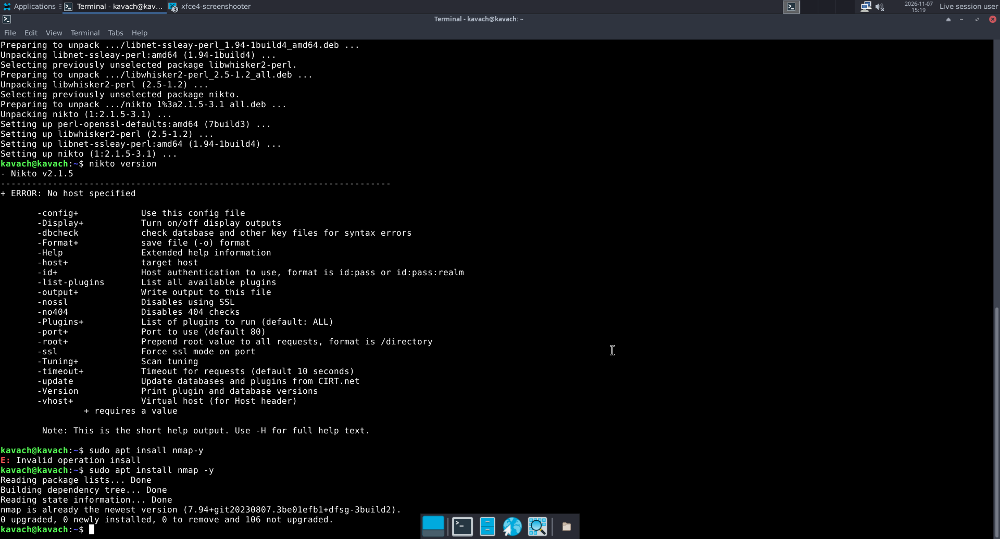
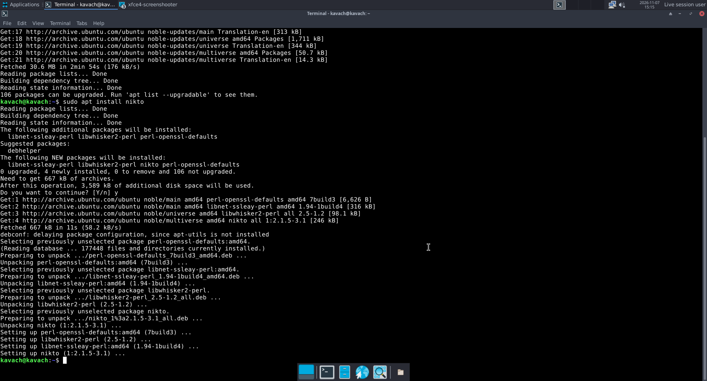
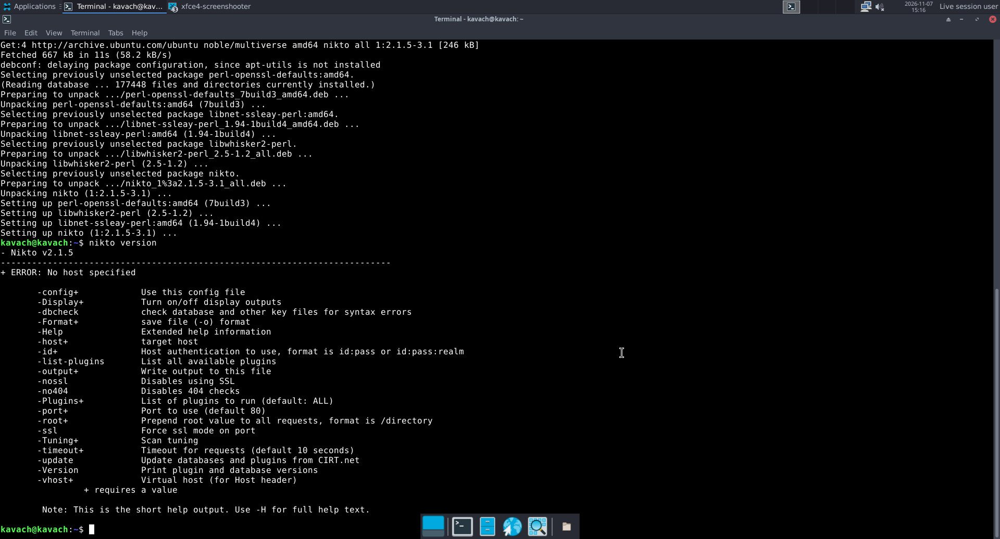

# Kavach Linux — "Rakshak" 1.0

A small project to build bootable **live Linux distributions** for cyber-security and digital-forensics practice. *Kavach* (कवच) means "armour" in Sanskrit/Hindi.

> **What this is, honestly:** a customised *remix*, not an operating system written from scratch. The kernel, BusyBox, the XFCE desktop, GRUB and every security tool are unmodified packages from **Ubuntu 24.04**. The original work in this repository is the **build scripts, boot configuration, branding, helper commands and documentation** that assemble them into bootable ISO images. Parts of the scripts were written with AI assistance.



## Screenshots

Live session of the desktop edition (XFCE panel and dock, terminal, package installs working over the network):

| Installing a tool with apt | Running it | nmap already included |
|---|---|---|
|  |  |  |

## Two editions

| | **CLI edition** | **Desktop edition** |
|---|---|---|
| ISO size | ~29 MB | ~1.4 GB |
| Interface | text console | XFCE desktop (Arc-Dark theme) |
| Userland | BusyBox + Ubuntu kernel | Ubuntu 24.04 packages |
| Tools | helper command `kavach` + BusyBox applets | nmap, Wireshark, tcpdump, Sleuth Kit, foremost, binwalk, TestDisk, ddrescue, exiftool, John the Ripper, Hydra, aircrack-ng, GHex, GParted |
| Min. RAM | 256 MB | 2 GB (4 GB recommended) |
| Boot | BIOS (GRUB) | BIOS + UEFI hybrid ISO (GRUB + casper live-boot) |
| Persistence | none | none |
| Docs | [docs/CLI-Edition.md](docs/CLI-Edition.md) | [docs/Desktop-Edition.md](docs/Desktop-Edition.md) |

## Download

ISOs are too large for the repository itself and are attached to the **[Releases](../../releases)** page.

| File | SHA-256 |
|---|---|
| `kavach-linux-desktop-1.0.iso` | `a7b62221b5ab51ee57fed126914097d02bc56f8014172e52a7d2bb9918d45590` |
| `kavach-linux-1.0.iso` (CLI) | `3d56ff3b23451479cc8601f3cbcef0f3579b06eab396e6e16cef0edbbeaa9fea` |

Verify after downloading — Windows: `certutil -hashfile <file> SHA256` · Linux/macOS: `sha256sum <file>`.

## Quick start (VirtualBox)

1. New VM → Type **Linux**, Version **Ubuntu (64-bit)**, skip unattended install.
2. **2048 MB+ RAM** (desktop), 2 CPUs, **no hard disk**, EFI off.
3. Display → Graphics Controller **VMSVGA**, 128 MB video memory. Attach the ISO to the optical drive.
4. Start. In the GRUB menu choose the first entry. If the display fails, choose **"safe graphics: nomodeset"**.

The desktop edition logs in automatically as `kavach` (no password, passwordless sudo — a lab convenience; do not expose it to untrusted networks).

## The `kavach` helper command

A small shell tool included in both editions (the CLI and desktop versions differ slightly):

```
kavach info                  system information
kavach hash <file>           MD5 / SHA-1 / SHA-256
kavach disks                 list block devices
kavach image <src> <dst>     copy a device to a file (dd in CLI edition, ddrescue in desktop) + SHA-256
kavach mountro <dev> [dir]   mount read-only (ro,noexec,nosuid,nodev)
kavach net                   network state
```
The CLI edition additionally has `hexview` and `strings`.

> **Not a forensic write-blocker.** Linux can still auto-mount drives you attach in the desktop file manager. For evidence handling, attach disks read-only at the hypervisor level and use `kavach mountro`.

## Repository layout

```
cli-edition/build.sh        builds the 29 MB BusyBox-based ISO
desktop/chroot-setup.sh     package list, theming, helper command (runs inside the chroot)
desktop/build-desktop.sh    the end-to-end build steps for the desktop ISO
desktop/grub.cfg            boot menu
desktop/wallpaper.png       branding
tools/gen_wallpaper.py      generates the wallpaper
docs/                       full documentation for both editions
```

## Building from source

Requires root on Ubuntu 24.04, ~10 GB free disk and internet. See [docs/Desktop-Edition.md](docs/Desktop-Edition.md) §4.

```bash
sudo ./desktop/build-desktop.sh
```

**Caveats:** `build-desktop.sh` collects the steps that were run by hand to produce the released ISO; it has **not been run start-to-finish as one script**, so expect small fixes. `cli-edition/build.sh` contains hard-coded paths at the top (kernel extraction directory, work and output folders) that you must adjust.

## Status and testing

| Item | Status |
|---|---|
| CLI edition boots, logs in, DHCP, `kavach` commands | ✅ tested in QEMU (BIOS) |
| Desktop edition boots to XFCE with autologin | ✅ tested in QEMU (BIOS, 2 GB RAM, no KVM) |
| Desktop: network connects after boot | ✅ tray icon showed connected in QEMU; author's screenshots show `apt update` (30.6 MB fetched) and `apt install nikto` working in the live session |
| Desktop: nmap and Nikto | ✅ nmap 7.94 present; Nikto installed via apt and its help output runs (author's screenshots) |
| Desktop in VirtualBox | ⚠️ reported working **only** with the "safe graphics (nomodeset)" entry; normal entries failed with a "file not found" message — under investigation |
| Desktop `kavach` commands | ❌ not tested |
| UEFI boot, real hardware, USB boot, VMware | ❌ not tested |
| Screen auto-resize, clipboard, sound | ❌ not tested |
| Every individual security tool | ❌ not tested |

## Known limitations

- Live system only: no installer, nothing is saved between boots.
- No Secure Boot support; no Wi-Fi in the CLI edition.
- Browser is Epiphany only (Firefox/Chromium are snap-only on Ubuntu).
- Boot is slow without hardware virtualisation (~7–8 minutes in an emulated test).

See [ROADMAP.md](ROADMAP.md) for planned work.

## Responsible use

The included tools can be used to test and attack systems. Use them **only on systems you own or have explicit written permission to test**. The authors accept no responsibility for misuse.

## Licensing

- The scripts, documentation and helper tools in this repository are released under the **MIT License** (see [LICENSE](LICENSE)).
- The ISO images bundle third-party software under its own licences, mostly GPL-family: the Linux kernel (GPL-2.0), BusyBox (GPL-2.0), GRUB (GPL-3.0), XFCE, Wireshark, nmap (Nmap Public Source License), John the Ripper and many more. If you redistribute an ISO you must comply with those licences, including making the corresponding source available. The source packages are available from the Ubuntu 24.04 ("noble") archive.
- "Ubuntu", "Kali" and other third-party names and logos belong to their owners. Kavach Linux is an independent project, is not affiliated with or endorsed by them, and does not use their branding.
